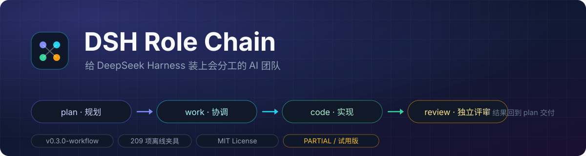
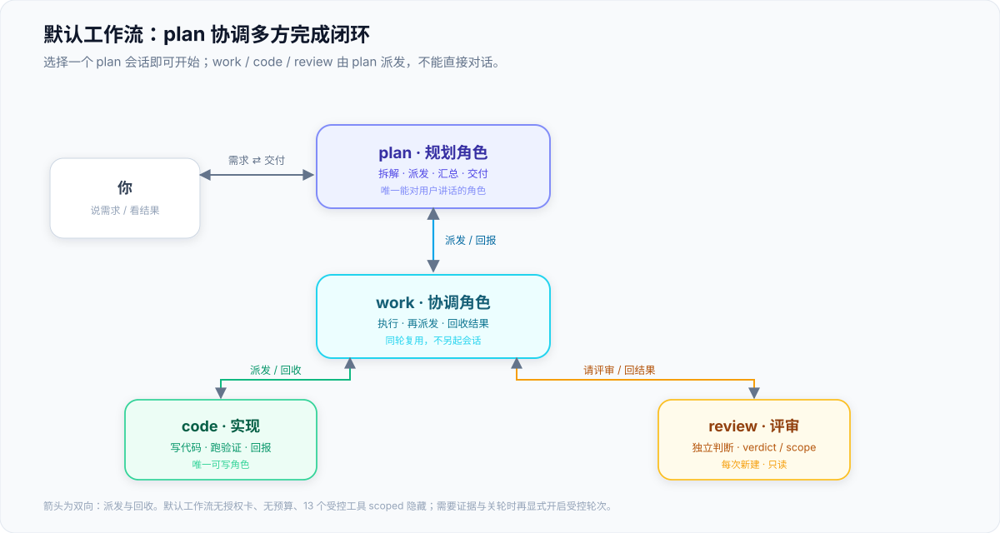
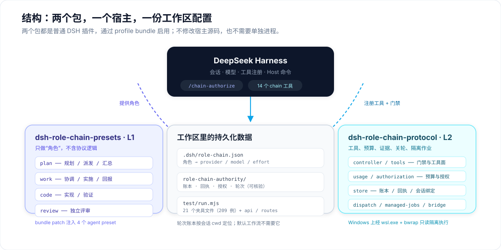
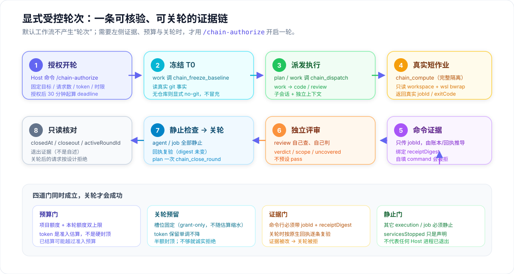
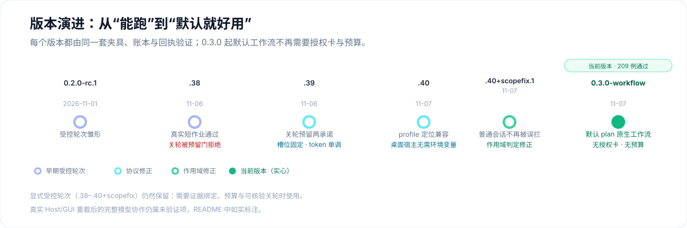

<div align="center">
  
</div>

<div align="center">

**给 [DeepSeek Harness](https://github.com/deepseek-ai/deepseek-harness) 装上会分工的 AI 团队。**

选择 `plan`，说一句需求；规划、协调、实现、独立评审自动发生，最后由 plan 向你交付。

[](https://github.com/Weihao654/dsh-workflow/releases)
[](#包结构)
[](#验证)
[](LICENSE)
[](#已知限制)

</div>

---

## 目录

- [这是什么](#这是什么)
- [30 秒上手](#30-秒上手)
- [默认工作流](#默认工作流)
- [包结构](#包结构)
- [显式受控轮次](#显式受控轮次)
- [验证](#验证)
- [版本历史](#版本历史)
- [已知限制](#已知限制)
- [文档](#文档)
- [发布](#发布)

## 这是什么

DSH 原生只有“一个会话对一条消息”。**Role Chain 把它变成一个 4 人小组**：

| 角色 | 职责 | 关键约束 |
|:--:|---|---|
| 🧭 **plan** | 拆解任务、派发、汇总、面向用户交付 | 唯一能对用户讲话的角色；只读 |
| 🛠 **work** | 协调执行、把任务派给 code / review、回收结果 | 同轮复用；只读 |
| ⚙️ **code** | 写代码、跑验证、回报真实结果 | 唯一可写角色 |
| 🔍 **review** | 独立判断，给出 verdict / scope / uncovered | 每次新建、独立上下文；只读 |

一个伞包装齐、零宿主改动、无需单独进程 —— 通过 DSH 插件机制加载：

- **不用**先填额度、启动轮次或逐步批准；
- **不会**把日常使用套进预算与关轮账本；
- 需要证据与可核验关轮时，仍保留**显式受控轮次**。

> [!NOTE]
> 当前为 **PARTIAL / 试用版**。209 例离线夹具与 api/routes 脚本全绿；重开后的真实 Host/GUI 加载与完整模型协作仍是未验证项，详见[已知限制](#已知限制)。

## 30 秒上手

1. 安装并启用伞包 `dsh-role-chain`（一条命令装齐 L1 预设 + L2 协议）：

   ```powershell
   dsh plugin --profile <profile> add github:Weihao654/dsh-workflow#path:/plugins/role-chain
   ```

2. 新建会话，在输入框上方把座位切到 **`plan（方案角色…）`**；
3. 直接说需求。简单问答 plan 直接回答；实施任务自动按下面的链路回流。

> [!TIP]
> 想分开装也可以只启用 [L1](<plugins/l1-presets/README.md>) 与 [L2](<plugins/l2-protocol/README.md>) 两个源码包；它们与伞包插入同一批 loader 行，**不要同时启用**，从旧的两条迁移过来时先移除旧条目。

```text
你 ──► plan ──► work ──► code ──► work ──► review ──► work ──► plan ──► 你
```

work / code / review 由 plan 派发，**不能直接对话**；你只和 plan 交互。

## 默认工作流



- 选择 plan，直接发消息；只有缺少关键资料、需要业务取舍或超出范围时才问你。
- **不创建** L2 授权/用量账本，不套输出上限、请求计数、关轮预留，也**不强制** `chain_compute`。
- 14 个 `chain_*` 工具中的 13 个（除 `chain_role_models` 外）通过官方 scoped `tools.restrict` 对新工作流隐藏；原生工具、权限与角色模型设置保持有效。
- plan/work 只读、code 写入、review 只读 —— 这是**提示词约定，不是文件系统隔离**。
- 默认工作流下没有授权卡；需要预算/证据/关轮时才显式开启受控轮次。

## 包结构



推荐安装的是**伞包**：它把下面两个源码包的内容镜像进一个包，装一次就有四个预置、14 个工具和设置卡。

| 包 | 版本 | 用途 | 边界 |
|---|---|---|---|
| [**伞包 · dsh-role-chain**](<plugins/role-chain/README.md>) | `0.1.0`（内含 L1 `1.1.0-workflow.1` · L2 `0.3.0-workflow.20261107.2`） | 一条命令装齐角色预设、协议运行时与设置卡；`lib/` 与 `bridge/` 是 L2 源码的镜像，生成物可复现 | 推荐安装；与下面两个源码包**不可同时启用**（同一批 loader id） |
| [**L1 · 角色预设**](<plugins/l1-presets/README.md>) | `1.1.0-workflow.1` | `plan / work / code / review` 四个 agent preset 及协作协议；bundle patch 注入 | 源码包，可独立使用；没有 L2 时纪律主要依靠提示词与人工检查 |
| [**L2 · 轮次协议**](<plugins/l2-protocol/README.md>) | `0.3.0-workflow.20261107.2` | 默认 plan 原生工作流、14 个工具、受控派发/停止、账本、模型设置卡、受控隔离作业 | 源码包；需要当前 Host API；真实 Host/GUI 集成验收未完成 |

模型设置保留标准内置预设与 plan 的新会话入口，仅隐藏内部 work/code/review；手动选模优先于项目角色映射，effort 来自实际模型元数据、不硬编码档位。

## 显式受控轮次



需要“可核验的证据链”时（例如让模型真的跑一次作业、并留下可复查的回执）：

```text
/chain-authorize {"authorizationId":"…","goal":"…","budget":{…}}
```

这是 **Host 命令**（不产生模型请求）：授权即开轮、冻结额度，`deadlineAt = 授权时刻 + wallMinutes`，此后不可改额、必须先于任何轮次。

之后由角色按固定顺序推进：

1. **work 冻结 T0** —— 只读真实 git 事实；无仓库则显式 `no-git`，不冒充。
2. **派发执行** —— `chain_dispatch` 把任务交给 work / code / 独立 review。
3. **真实短作业** —— `chain_compute` 在完整隔离下执行（Windows 经 `wsl.exe` + `bwrap` 只读 workspace）；隔离不完整就拒绝，不回退裸 shell。
4. **命令证据** —— 只传 `jobId`，命令、退出码、`receiptDigest` 一律从账本与原生回执推导；自填“成功”会被 `EVIDENCE_MISMATCH` 拒绝。
5. **独立评审** —— review 自己查、自己判，给 `verdict / scope / uncovered`；不预设 pass。
6. **静止检查 → 关轮** —— 其它 execution/job 全部静止、回执逐条复验后，plan 一次 `chain_close_round`。

**关轮预留分两个独立承诺**（`.39` 起）：槽位只来自授权（`min(closeoutRequests, 请求数/4)`，不随估算重算）；token 预留随输入估算单调不减，并受半额预算封顶；每次关轮按“自身输入 + 输出上限”与该预留比较，不会透支，也不靠单个数字例子“证明正确”。

> [!IMPORTANT]
> `servicesStopped` 只是**声明**：机器门只证明受控执行体与作业静止，**不证明任何 Host 进程已退出**。关轮后的下一次请求按设计返回 `ROUND_CLOSED`，不是故障。

## 验证

从 L2 包目录执行：

```powershell
node test/run.mjs                 # 21 个夹具文件、209 例（默认每文件独立子进程）
node test/run.mjs --in-process    # 沙箱禁止 spawn 时的等价回退
node test/api.mjs                 # HTTP API 脚本
node test/routes.mjs              # 路由脚本
```

伞包自带生成物校验与独立测试：

```powershell
node scripts/sync-umbrella.mjs --check   # 镜像是否与 L2 源码逐字节一致（31 个文件）
node test/run.mjs --in-process           # 16 例：生成物、模块 id、目录布局
```

- 夹具以**真实控制器 + 假 Host/Agent** 为主，确定性执行，**不产生付费模型请求**。
- Windows 原生短任务测试会启动真实监督器与子孙进程，但显式使用 **fake-full 隔离契约**：只检查原生 Job、期限、参数与停止竞态，不能据此证明安全隔离、真实 Host 崩溃恢复或生产可用性。
- Git 基线查询禁用已发现的过滤器及 fsmonitor/hook 回调，跳过子模块脏状态检查；该 dirty 结果只覆盖顶层工作树，可能不同于普通 `git status`。
- 测试结果与未覆盖项见 [验收说明](<plugins/l2-protocol/ACCEPTANCE.md>)。

## 版本历史



| 版本 | 内容 |
|---|---|
| **0.3.0-workflow.20261107.2** | 默认 plan 原生工作流（无授权卡/预算）；受控工具经 scoped filter 隐藏；209 例夹具 |
| 0.2.1-rc.20261107.40+scopefix.1 | 普通会话不再被要求轮次绑定；新增 session 位置校验 |
| 0.2.1-rc.20261107.40 | 无 `DSH_PROFILE_DIR` 时从安装路径推导 profile；失败即拒绝而非猜测 |
| 0.2.1-rc.20261106.39 | 关轮预留修正：槽位承诺固定、token 预留单调、关轮含当前输入 |
| 0.2.1-rc.20261106.38 | 真实短作业 + 独立 review 证据；关轮曾被预留拒绝（.39 修复） |
| 0.2.0-rc.1 | 受控轮次、派发/停止、账本项目与证据门禁 |

## 已知限制

- **未验证**：重开后的真实 Host/GUI 加载、完整模型协作、`chain_compute` 在其他机器/配置上的可用性；安装与离线验证期间真实模型请求为 **0**。
- **受控轮次仍是试用级**：不是预付费绝对 token 上限，也不是账单；已结算可能越过准入预算，成本不可知属正常。
- **隔离边界**：只读 workspace + `bwrap` 命名空间；Windows Job 只负责进程范围与期限，**不是文件安全沙箱**。
- 旧受控路径的重复计量缺陷未修；旧受控任务不因升级续额或重置，新日常任务新建 plan 即可。
- 关闭/停止的根 plan 会话不自动恢复推理；下一轮需要新的根 plan 会话。

## 文档

| 文档 | 内容 |
|---|---|
| [伞包安装与镜像说明](<plugins/role-chain/README.md>) | 一条命令安装、迁移步骤、镜像与模块 id 约定、开发校验 |
| [L2 使用说明](<plugins/l2-protocol/README.md>) | 工具、默认工作流、受控轮次的具体行为 |
| [L2 设计与限制](<plugins/l2-protocol/DESIGN.md>) | 架构、状态机、不做的事 |
| [L2 验收范围](<plugins/l2-protocol/ACCEPTANCE.md>) | 每个版本变了什么、验证了什么、没验证什么 |
| [证据索引](<plugins/l2-protocol/evidence-index.json>) | 机器可读的验证证据与缺口 |

## 发布

- 仓库：[**Weihao654/dsh-workflow**](https://github.com/Weihao654/dsh-workflow)
- 市场条目（推荐安装，已合并）：[PR #13413](https://github.com/awesome-dsh-plugin/awesome-dsh-plugin/pull/13413) → `Weihao654/dsh-workflow#role-chain`
- 旧的两条源码包条目：[PR #10945](https://github.com/awesome-dsh-plugin/awesome-dsh-plugin/pull/10945) → `#l1-presets` 与 `#l2-protocol`

## License

MIT。包内链路图标为本项目原创 SVG；架构说明图不是插件运行截图。
