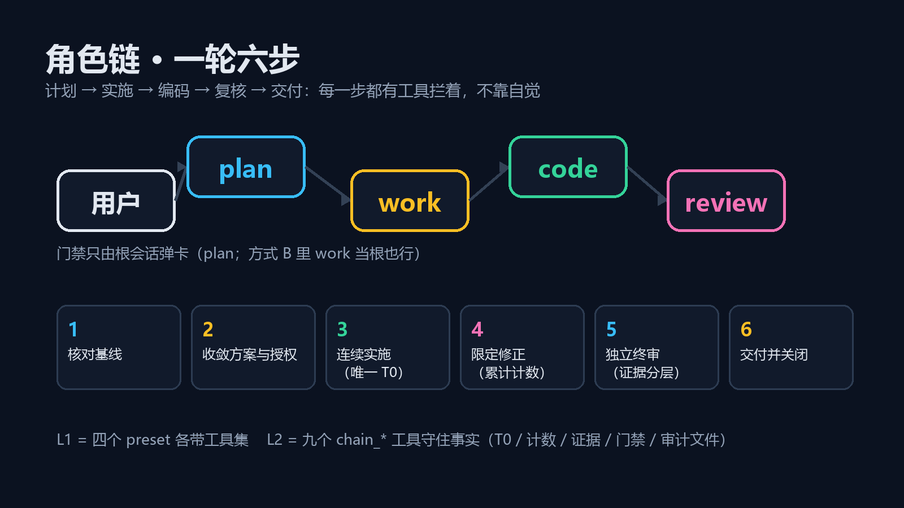

# 轮次协议 · Role Chain Protocol

> **状态：v0.1（P0）已实现、已安装、已自测。** 9 个工具全部注册（激活日志见下），状态机 21 条自测全过。**尚未验证的只有两件事**：真实会话里"角色看不见不该有的工具"是否成立、`chain_gate` 是否真的弹出卡片等人回答——这两条需要你新开一个 plan 会话点一下，步骤见 [ACCEPTANCE.md](./ACCEPTANCE.md)。

一句话：把 `plan → work → code → work → review → work → plan` 这条角色链，从"靠提示词自觉"变成**可执行、可审计的轮次状态机**。



---

## 它是什么

DSH 已经能声明四个角色（本仓库的 `plugins/l1-presets` 做到了：plan / work / code / review 各自的人设与工具集），但管不住**纪律**：T0 是不是唯一、失败到底重试了几次、证据是谁给的、这一轮花了多少、什么时候算关闭。这些在 L1 里全靠模型自觉加人眼检查，事后无法审计。

这个插件补的就是这一层。它不新增角色，也不改源码工具——它在四个角色上面加一层 `chain_*` 协议工具，把六步里"必须成立的事实"写进磁盘、卡在工具调用上。

## 它拦得住什么（已实现，且自测覆盖）

| 规则 | 怎么拦 | 自测 |
|---|---|---|
| 一轮只有一个 T0 | `chain_freeze_baseline` 第二次调用抛 `BASELINE_ALREADY_FROZEN`；插件自己跑 `git rev-parse HEAD` / `git status --porcelain`，不听模型自述 | ✅ |
| 证据必须绑本轮 T0 | 每条证据写入时自动打上本轮 `t0Id`；没有 T0 时写证据抛 `NO_BASELINE` | ✅ |
| 证据分层、不互相扩大 | 层与角色绑定：`command` / `artifact` 仅 work·code，`review` 仅 review，`self-report` 全部但标记为未独立验证 | ✅ |
| "同一个测试失败 3 次"是真的 3 次 | 按**失败签名**累计，不同签名互不影响 | ✅ |
| 计数越限就关不掉这一轮 | `chain_close_round` 六项校验；越限时找不到 `kind:'force'` 且被批准的门禁记录就拒绝 | ✅ |
| 需要用户拍板时真的等人 | `chain_gate` 走 `userQuestions.ask`，阻塞到人点选；子代理调用返回 `ESCALATE_TO_PARENT` | ✅ 逻辑 · ⏳ 卡片待你验证 |
| 交付结论是算出来的 | 版本 / 结果 / 未覆盖项 / 费用 / 服务已停 由插件校验并组装，通过后自动落 `.dsh/rounds/<roundId>.json` | ✅ |
| 关掉的轮不能改事实 | 已关闭轮次的写操作抛 `ROUND_CLOSED`；同一时间只能有一轮未关闭 | ✅ |

## 它拦不住什么（别指望它）

- **"实施要连续"**：插件不知道中途有没有换人，只能看证据时间线。
- **"修正要限定、不许顺手改别的"**：`chain_check_baseline` 能给出"相对 T0 脏/commit 变了"，但"这些改动是否都在工单范围内"要比对规则，属 P2。
- **"结论不能超出证据范围"**：分层保证不混层，"这条证据能支撑多大结论"仍要 review 自己写 `scope` / `uncovered`。
- **模型敷衍**：它把"没证据就关不了轮"变成硬约束，但不能让证据本身变真。
- **work 的只读是软的**：work 这个人设里有 shell，重定向照样能写文件（L1 遗留，见 §已知缺口）。

## 十个工具

| 工具 | 谁能调 | 干什么 |
|---|---|---|
| `chain_open_round` | plan | 开一轮，定目标与预算（token / 修正 / 重跑 / 重启） |
| `chain_freeze_baseline` | work | 冻结唯一 T0（插件自己跑 git） |
| `chain_check_baseline` | 全部 | 当前工作区 vs T0 的漂移（`clean` / `baseline-dirty` / `baseline-moved`） |
| `chain_record_failure` | work / code | 失败 / 修正 / 重跑 / 重启按签名计数，到上限即 `exceeded` |
| `chain_record_evidence` | 全部（分层限权） | 记一条证据，自动绑 T0 |
| `chain_gate` | 根角色 | 阻塞式问人，决策入库；子代理只得到 `ESCALATE_TO_PARENT` |
| `chain_close_round` | plan | 六项校验后关闭，产出结论与审计副本 |
| `chain_status` | 全部 | 只读看板：当前轮、T0、预算与计数、失败签名、证据、门禁 |
| `chain_export_audit` | plan | 把整轮导出成 `.dsh/rounds/<roundId>.json` |
| `chain_role_models` | 全部（改表限根会话） | 读 / 改「角色→模型」表，写进项目的 `.dsh/role-chain.json`；`listModels` 列可选模型，写前默认校验 |

## 角色→模型（plan 用强模型，code 用便宜模型）

默认四个角色共用一个模型：子代理会继承父代理的 AgentOptions。要按角色分工，在**项目里**放一张表就行：

`<项目根>/.dsh/role-chain.json`

```json
{
  "roleModels": {
    "plan": { "provider": "deepseek-account", "model": "deepseek-flash", "reasoningEffort": "high" },
    "code": { "provider": "openai", "model": "gpt-6-luna" }
  }
}
```

- 只写想改的角色；没写的角色保持原样。
- `provider` / `model` 必须与 DSH 里配置的**完全一致**（以输入框模型菜单里显示的为准）。
- `reasoningEffort` 可选；换了模型却没写它时，旧的 effort 会被丢弃（effort id 是跟模型绑的）。
- `"enabled": false` 整体关掉。
- 改完**下一轮请求就生效**，不用重启、不用改 YAML。
- **手选优先**：一旦你在输入框手动换过模型，那个会话就不再被路由覆盖。
- 表写坏了不会中断对话：解析失败时路由整体停用，原因回显在 `chain_status.roleModels.errors`。

`chain_status` 会回显：表在哪、解析出什么、本会话实际生效的是哪条（`thisSession.applied`）、是不是已经让位给手选（`thisSession.manual`）。

### 两种改法

**一、在对话里改**（不用碰文件）——让 plan 调 `chain_role_models`：

```text
chain_role_models({ listModels: true })       // 先看有哪些 provider / model id 可填
chain_role_models({ set: { code: { provider: "openai", model: "gpt-6-luna", reasoningEffort: "low" } } })
chain_role_models({ clear: ["review"] })      // 删掉某个角色的映射
chain_role_models({ enabled: false })         // 整体暂停，表保留
chain_role_models({})                         // 只看现在是什么
```

`listModels` 与输入框的模型选择器同源（都走 `llm.listProviders()` / `llm.listModels()`），所以它列出来的 id 就是能直接填的 id。

**写前校验**：`set` 里每条路由都会先过 `llm.resolveModelInfo(provider, model)`。provider/model 不存在，或 `reasoningEffort` 不是该模型公布的档位，就**整次拒写**并回 `ROUTE_UNKNOWN` + 原因（不猜、不降级——写错了那一环会直接失败）。确认要用就带 `skipValidation: true`。

它写的是同一个文件，原子写入（临时文件 + rename），未知角色、缺 `provider`/`model` 会被拒且不动原文件。改表只允许根会话（plan）发起；子代理调用会得到 `ESCALATE_TO_PARENT`，把请求带回 plan 即可。

**二、直接编辑 `<项目根>/.dsh/role-chain.json`** —— 编辑器、git、脚本都行，见上面的字段说明。

**三、在设置里点选** —— DSH 设置 → **角色 → 模型**：四行（plan / work / code / review）× 三个下拉（provider / 模型 / 思考深度）+ 一个「启用这张表」开关，保存即写同一个文件。

- 卡片读的是**最近一个会话所在的项目**（表是跟项目的）；想改别的项目，用 `/role-chain/api/table?cwd=<项目根>` 读一次即可让卡片记下那个路径。
- 写走同一个 `saveRoleModels()`，也过同一道 `llm.resolveModelInfo` 校验：模型 id 写错会当场被拒并显示原因，不会把表写坏。
- 这张卡是客户端半身 + 一条 host 路由（`GET/POST /role-chain/api/table`，写要带 `x-role-chain: 1` 头，防跨站页面借 loopback 写文件），不依赖 Remote 网关。
- 改了客户端半身必须**重启 DSH** 才生效（客户端模块在启动时装配）。

机制是一行宿主监听：`agent/request` 瀑布（每步请求前）读 `session.header.agentPreset` 认出角色，查表替换 `provider` / `model`。所以它不依赖 preset、不依赖 YAML，也不需要重装。

## 新建会话菜单

装了这个 bundle 后，新建会话的预设菜单只保留 DSH 自带的那几项 + `plan`；`work` / `code` / `review` 不出现在菜单里，它们只由 plan 派发。

实现方式是客户端把 `agentPresets.list()` 的返回过滤掉这三个 id，**不改 DSH 自己的选择器控件**。万一包装没装上，菜单会退回显示全部——失败开放，不会白屏。

## 六步怎么映射到工具

| 协议步骤 | 工具 |
|---|---|
| 1 核对基线 | `chain_status`（看有没有未关闭的轮）→ `chain_open_round` |
| 2 收敛方案与授权 | `chain_gate kind=scope`（要新权限/新预算时） |
| 3 连续实施（唯一 T0） | `chain_freeze_baseline` 一次 → `chain_record_evidence layer=command/artifact` |
| 4 限定修正 | `chain_record_failure` → 到上限时 `chain_gate kind=force` |
| 5 独立终审 | review 会话 `chain_record_evidence layer=review`（verdict + scope + uncovered） |
| 6 交付并关闭 | `chain_close_round` → 自动落审计文件 |

## 安装与前置

1. 先装本仓库的 `plugins/l1-presets`（四个 preset 就位：plan / work / code / review）。
2. 再装本 bundle：`plugin_manager install_bundle` 指向本目录，然后重载 Loader 或新开会话。
3. **必须新开会话**：preset 修订与工具集在会话创建时冻结。

已在本机验证：profile 里 `include:role-chain-protocol` → `enabled: true, fiberPhase: active`，激活日志：

```
[info] [role-chain] 9 个 chain_* 工具已注册 [host.kernel.role-chain-protocol] {"pluginId":"include:role-chain-protocol"}
```

## 与设计的三处偏差（如实记录）

| 设计（DESIGN.md） | P0 实际 | 为什么 |
|---|---|---|
| 状态存 `dsh-storage-domain` | 存 `<cwd>/.dsh/rounds/state.json`（原子写：tmp + rename），每轮另落 `<roundId>.json` | profile 的 `zod` 是 3.25.76，而 `@deepseek-ai/dsh-storage-domain` 要求 zod 4.4.3；P0 不往 bundle 里塞第二份 zod。附带好处：权威副本与审计副本是同一份文件 |
| 4 个 preset 子行各注册本角色工具（结构性"看不见"） | **1 个全局行**注册 9 个工具，工具内部按角色拒绝（`ROLE_DENIED`） | §10.B / §10.C 未验证（子行工具是否 agent 作用域、能否 inject 宿主全局服务）。先保证"错的角色调用会被拒"，再谈"看不见" |
| 越限判定 `counters.* > limit` | `>= limit`（到上限即停，不是超一格才停） | "同一测试失败 3 次停下"指的是第 3 次就停 |

这三条都写进了 `DESIGN.md` §15。迁移路径：P1 换回 storageDomain（bundle 自带 zod 4）并把工具注册搬到 preset 子行。

## 已知缺口

1. **同轮并发**：状态文件按 cwd 单实例串行写，但两个会话同时开轮时后开的会被 `ROUND_ALREADY_OPEN` 拒绝——这是设计意图，不是 bug；真正缺的是"多会话共享同一轮"的看板刷新。
2. **费用**：`closeout.cost` 目前由调用方填（`tokenMeter` 自动累加属 P2），支持 `costOverride` 人工覆盖并标 `estimate:false`。
3. **崩溃恢复**：状态在磁盘上，进程重启后 `chain_status` 能读回；但"进行中的工具调用"没有事务，最坏情况是某条证据没落盘——重记一次即可。
4. **非 git 项目**：T0 记 `mode:'no-git'`，`version.commit` 写 `"(no-git)"`；文件哈希清单属 P2。
5. **work 的只读是软的**（见上）。
6. **preset 不能中途换**：一轮里想改角色纪律，只能新开会话。

## 文件

```
package.json              # dsh-role-chain-protocol 0.1.0, dsh.bundle.patch, dsh.client
cordis.patch.yml          # 1 个全局行 role-chain-protocol
lib/index.js              # 插件入口：inject ['tools']，注册 10 个工具 + agent/request 路由 + 设置页 API
lib/roles.js              # 角色判定：SessionHeader.agentPreset / composedPreset / 是否根 / cwd
lib/service.js            # 状态机全部逻辑（开轮/T0/计数/证据/门禁/关闭/看板）
lib/store.js              # 原子 JSON 状态存储，按 cwd 单实例
lib/tools.js              # 10 个工具定义 + 角色拒绝 + chain_status 回显模型映射
lib/role-models.js        # 角色→模型：读 .dsh/role-chain.json，agent/request 瀑布换模型，手选优先
lib/api.js                # 设置页用的 HTTP 接口：GET/POST /role-chain/api/table
lib/client.js             # 客户端半身：过滤新建菜单 + 「角色 → 模型」设置卡片
role-chain.example.json   # 角色→模型表的样子
test/smoke.mjs            # 无宿主自测：21 条断言，node test/smoke.mjs
test/routes.mjs           # 路由自测：58 条断言，node test/routes.mjs
test/api.mjs              # 设置页 API 自测：38 条断言，node test/api.mjs
DESIGN.md                 # 接口骨架 + §15 实施记录 + §16 模型路由 + §17/§18 界面
ACCEPTANCE.md             # 30 秒验收清单
```

## 关键词

`deepseek-harness` `dsh` `cordis` `plugin` `workflow` `round` `audit` `subagent` `role-chain`
