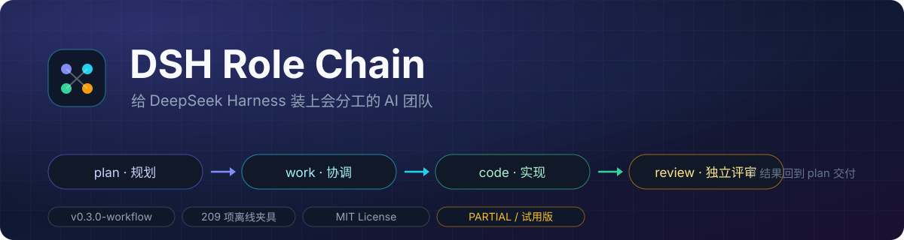
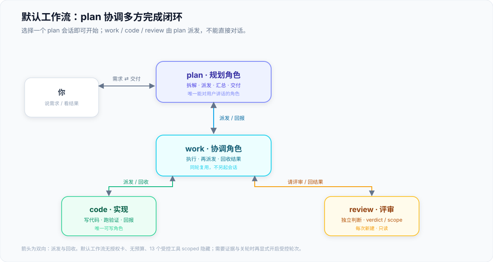
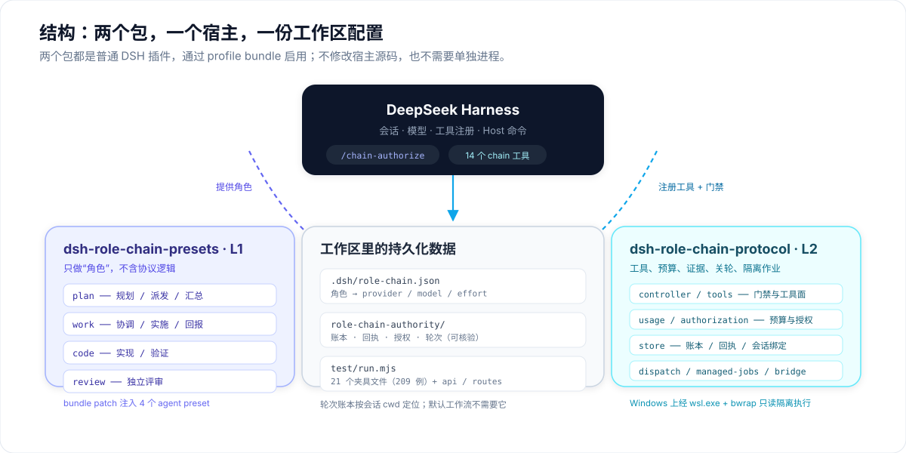
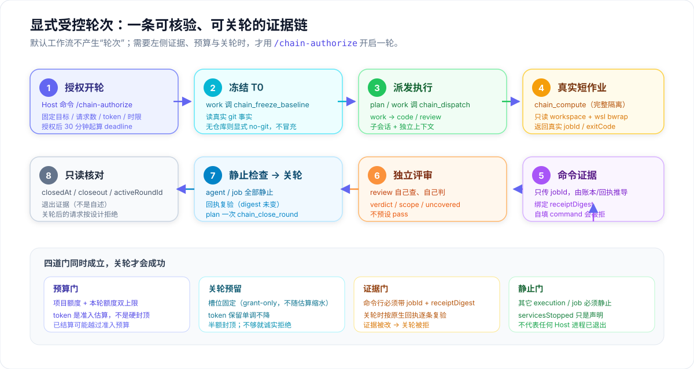

# 给 DeepSeek Harness 装上会分工的 AI 团队



**一个 bundle 装齐：四个角色预设 + 14 个 `chain_*` 工具 + 设置卡。**

选择 `plan`，说一句需求；规划、协调、实现、独立评审自动发生，最后由 plan 向你交付。

DSH 原生只有"一个会话对一条消息"。**Role Chain 把它变成一个 4 人小组**：

| 角色 | 职责 | 关键约束 |
|:--:|---|---|
| 🧭 **plan** | 拆解任务、派发、汇总、面向用户交付 | 唯一能对用户讲话的角色；只读 |
| 🛠 **work** | 协调执行、把任务派给 code / review、回收结果 | 同轮复用；只读 |
| ⚙️ **code** | 写代码、跑验证、回报真实结果 | 唯一可写角色 |
| 🔍 **review** | 独立判断，给出 verdict / scope / uncovered | 每次新建、独立上下文；只读 |

一个伞包装齐、零宿主改动、无需单独进程 —— 通过 DSH 插件机制加载：

- **不用**先填额度、启动轮次或逐步批准；
- **不会**把日常使用套进预算与关轮账本；
- 需要证据与可核验关轮时，仍保留**显式受控轮次**。

> **当前为 PARTIAL / 试用版。** 209 例离线夹具与 api/routes 脚本全绿；重开后的真实 Host/GUI
> 加载与完整模型协作仍是未验证项，见文末[明确未验证](#明确未验证)。

## 30 秒上手

1. 安装并启用伞包 `dsh-role-chain`（一条命令装齐 L1 预设 + L2 协议）：

   ```powershell
   dsh plugin --profile <profile> add github:Weihao654/dsh-workflow#path:/plugins/role-chain
   ```

2. 新建会话，在输入框上方把座位切到 **`plan（方案角色…）`**；
3. 直接说需求。简单问答 plan 直接回答；实施任务自动按下面的链路回流。

> 想分开装也可以只启用 L1 与 L2 两个源码包；它们与伞包插入同一批 loader 行，**不要同时启用**，
> 从旧的两条迁移过来时先移除旧条目（见[迁移](#从两个旧-bundle-迁移必须按此顺序)）。

```text
你 ──► plan ──► work ──► code ──► work ──► review ──► work ──► plan ──► 你
```

work / code / review 由 plan 派发，**不能直接对话**；你只和 plan 交互。

## 默认工作流



- 选择 plan，直接发消息；只有缺少关键资料、需要业务取舍或超出范围时才问你。
- **不创建** L2 授权/用量账本，不套输出上限、请求计数、关轮预留，也**不强制** `chain_compute`。
- 14 个 `chain_*` 工具中的 13 个（除 `chain_role_models` 外）通过官方 scoped `tools.restrict`
  对新工作流隐藏；原生工具、权限与角色模型设置保持有效。
- plan/work 只读、code 写入、review 只读 —— 这是**提示词约定，不是文件系统隔离**。
- 默认工作流下没有授权卡；需要预算/证据/关轮时才显式开启受控轮次。

## 包结构



推荐安装的是**伞包**：它把两个源码包的内容镜像进一个包，装一次就有四个预置、14 个工具和设置卡。

| 包 | 版本 | 用途 | 边界 |
|---|---|---|---|
| **伞包 · dsh-role-chain**（本包） | `0.1.0`（内含 L1 `1.1.0-workflow.1` · L2 `0.3.0-workflow.20261107.2`） | 一条命令装齐角色预设、协议运行时与设置卡；`lib/` 与 `bridge/` 是 L2 源码的镜像，生成物可复现 | 推荐安装；与下面两个源码包**不可同时启用**（同一批 loader id） |
| L1 · 角色预设 | `1.1.0-workflow.1` | `plan / work / code / review` 四个 agent preset 及协作协议；bundle patch 注入 | 源码包，可独立使用；没有 L2 时纪律主要依靠提示词与人工检查 |
| L2 · 轮次协议 | `0.3.0-workflow.20261107.2` | 默认 plan 原生工作流、14 个工具、受控派发/停止、账本、模型设置卡、受控隔离作业 | 源码包；需要当前 Host API；真实 Host/GUI 集成验收未完成 |

模型设置保留标准内置预设与 plan 的新会话入口，仅隐藏内部 work/code/review；手动选模优先于项目角色映射，
effort 来自实际模型元数据、不硬编码档位。

## 显式受控轮次



需要"可核验的证据链"时（例如让模型真的跑一次作业、并留下可复查的回执）：

```text
/chain-authorize {"authorizationId":"…","goal":"…","budget":{…}}
```

这是 **Host 命令**（不产生模型请求）：授权即开轮、冻结额度，`deadlineAt = 授权时刻 + wallMinutes`，
此后不可改额、必须先于任何轮次。

之后由角色按固定顺序推进：

1. **work 冻结 T0** —— 只读真实 git 事实；无仓库则显式 `no-git`，不冒充。
2. **派发执行** —— `chain_dispatch` 把任务交给 work / code / 独立 review。
3. **真实短作业** —— `chain_compute` 在完整隔离下执行（Windows 经 `wsl.exe` + `bwrap` 只读 workspace）；
   隔离不完整就拒绝，不回退裸 shell。
4. **命令证据** —— 只传 `jobId`，命令、退出码、`receiptDigest` 一律从账本与原生回执推导；
   自填"成功"会被 `EVIDENCE_MISMATCH` 拒绝。
5. **独立评审** —— review 自己查、自己判，给 `verdict / scope / uncovered`；不预设 pass。
6. **静止检查 → 关轮** —— 其它 execution/job 全部静止、回执逐条复验后，plan 一次 `chain_close_round`。

**关轮预留分两个独立承诺**（`.39` 起）：槽位只来自授权（`min(closeoutRequests, 请求数/4)`，不随估算重算）；
token 预留随输入估算单调不减，并受半额预算封顶；每次关轮按"自身输入 + 输出上限"与该预留比较，
不会透支，也不靠单个数字例子"证明正确"。

`servicesStopped` 只是**声明**：机器门只证明受控执行体与作业静止，**不证明任何 Host 进程已退出**。
关轮后的下一次请求按设计返回 `ROUND_CLOSED`，不是故障。

## 从两个旧 bundle 迁移（必须按此顺序）

> **迁移时必须先移除旧条目，再启用伞包。** 旧的两个 bundle 与伞包插入同一批 loader 行
> （`preset-*` ×4、`role-chain-protocol`）。同时启用在本机实测仍能启动、无报错、API 正常，
> 但重复 id 是**静默覆盖**：保留哪一份取决于 `dsh.profile.bundles` 的顺序。因此不要依赖顺序。

1. 备份 profile 的 `package.json`、`cordis.patch.yml`、`pnpm-lock.yaml`。
2. 从 `dsh.profile.bundles` 中删除 `dsh-role-chain-protocol` 与 `dsh-role-chain-presets`。
3. 删除这两个包的依赖/`node_modules` 链接（旧的 `vendor/` 副本可先保留，回退时再用）。
4. 安装并启用 `dsh-role-chain`，重启 Host。
5. 验证：`/role-chain/api/table` 返回 `{"ok":true,...}`，设置卡出现，`plan` 席位可用。

回退：还原第 1 步的三份文件，删除 `node_modules/dsh-role-chain`，重新装回两个旧包，按旧方式启用。

## 验证

```powershell
node scripts/sync-umbrella.mjs --check   # 镜像是否与 L2 源码逐字节一致（31 个文件）
node test/run.mjs --in-process           # 16 例：生成物、模块 id、目录布局
```

L2 的完整回归：`cd ../l2-protocol && node test/run.mjs --in-process`（209 例）。

## 明确未验证

- 真实市场 GUI 的一键安装（本仓库未发布到 npm；`dsh plugin … add github:…#path:/…` 已实测安装成功，
  但市场安装后的自动注册与后处理未在 GUI 中端到端实测）。
- 真实模型会话中的运行期工具注册与设置卡 GUI 渲染（目前证据是组合树、启动成功、API 与 client 入口）。
- 与旧两个 bundle 同时启用时，重复行被静默覆盖已实测（按 bundle 顺序后者生效），
  但"运行期到底实例化了几份插件"未直接观测到。

## 文档

| 文档 | 内容 |
|---|---|
| [仓库根 README](../../README.md) | 产品介绍、架构图、验证范围、版本历史 |
| [MIRROR.md](MIRROR.md) | 镜像是怎么生成的、`client.js` 为什么不同、发布前检查 |
| [L2 使用说明](../l2-protocol/README.md) | 工具与受控轮次的具体行为 |
| [L2 验收范围](../l2-protocol/ACCEPTANCE.md) | 每个版本变了什么、验证了什么、没验证什么 |

## License

MIT，见 [LICENSE](LICENSE)。内含的 L2 代码同样为 MIT（`plugins/l2-protocol/package.json`）。
